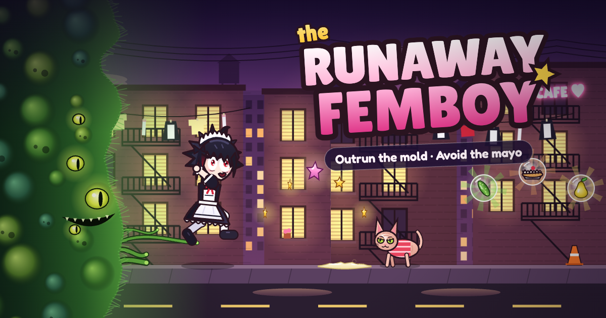

# The Runaway Femboy

[](https://trongateslegacy.github.io/the-runaway-femboy/)

A fan-made browser runner starring Astray (in a maid outfit). The Mold is right behind you. Run home, dodge pipes and binguses, avoid the mayo and get your regular back.

**Play it: https://trongateslegacy.github.io/the-runaway-femboy/**

Runs in any modern browser, on desktop or mobile, in portrait or landscape. Everything is drawn procedurally in Canvas 2D, so the build has no image assets.

## Play / develop

```bash
npm install
npm run dev        # http://localhost:5199 (also on your LAN, to test on a phone)
npm run build      # static site in dist/
npm run preview    # serve the built dist/
```

## Hosting

Every push to `main` deploys to GitHub Pages through `.github/workflows/pages.yml`.

`dist/` is a plain static folder with relative paths, so it can also go anywhere else:

- **itch.io**: zip the *contents* of `dist/`, upload it as an HTML game, and tick "Mobile friendly".
- **Netlify / Vercel / Cloudflare Pages**: build command `npm run build`, publish directory `dist`.

## Controls

| Action | Keyboard | Touch |
|---|---|---|
| Jump (tap again to double jump) | Space / ↑ / W | ▲ |
| Slide (fast-fall in the air) | ↓ / S | ▼ (hold) |
| Dash (uses stamina) | Shift / → / D | ⚡ (hold) |
| Slap (Pie Power only) | X / F | 🥧 |
| Pause | Esc / P | ⏸ |

## Gameplay

- **Pickle Power**: speed boost and infinite stamina.
- **Pie Power**: slap binguses, mayo jars, bottles and drips.
- **Pear Power**: invincible; smash through everything.
- **Endings**:
  - **Home Safe**: reach the house. You get your regular outfit back.
  - **Molded**: the mold catches you.
  - **Mayo'd**: the mayo meter fills up (bad ending).

## Audio

All audio is CC0. Sources and authors are in `public/audio/CREDITS.md`. Master volume defaults to 50%. Master, music, SFX and ambience each have their own slider in Settings, and the levels are saved per browser.

## Tests / tooling

These need the dev server running and a local Google Chrome:

- `node test/shoot.mjs [filter]`: screenshots of every screen (desktop, phone landscape, phone portrait) into `test/shots/`.
- `node test/strip.mjs`: a film strip of a full bot playthrough.
- `node test/playtest.mjs 6`: runs N full bot playthroughs and prints the ending, hits, closest mold distance and other stats.
